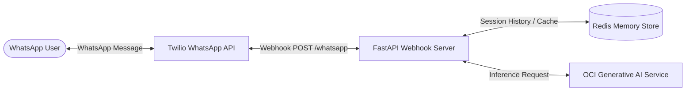

# OCI Generative AI WhatsApp Technical Support Assistant

> **AI-Powered Conversational IT Diagnostics and Support Assistant on WhatsApp**  
> Built with **Oracle Cloud Infrastructure (OCI) Generative AI**, **FastAPI**, **Redis**, and **Twilio API**.  
> **Author:** Abdallah AlNsour (*Oracle ACE Apprentice*)

---

## 📖 Overview

This repository provides an enterprise-ready conversational AI agent that delivers 24/7 technical troubleshooting and customer support directly through **WhatsApp**. 

Leveraging **Oracle Cloud Infrastructure (OCI) Generative AI**, the agent ("Hala") diagnoses hardware, network, software, and performance issues, guides employees step-by-step through troubleshooting runbooks, and retains contextual multi-turn conversation memory using **Redis**.

---

## 🏗️ Architecture



### Key Technical Capabilities:
- **OCI Generative AI Inference:** Interfaces directly with OCI Generative AI endpoints (`me-riyadh-1` / `us-chicago-1` / `us-phoenix-1`) supporting Cohere and Meta Llama models (`meta.llama-3.1-70b-instruct`).
- **Contextual Dialogue Memory:** Multi-turn conversational history cached in Redis with configurable expiration (`EXPIRE_TIME`) and automatic turn truncation (`MAX_HISTORY_MESSAGES`) to maintain cost and token efficiency.
- **WhatsApp Natural Formatting:** Translates standard markdown into clean WhatsApp formatting (`*bold*`, stripped headers) with interactive commands (e.g., `clear history`).
- **Built-in IT Troubleshooting Knowledge Base:** Step-by-step diagnosis workflows for high CPU/RAM usage, Wi-Fi/VPN connectivity, peripheral failures, and battery/charging faults.

---

## 📂 Project Structure

```
whatsappAgent/
├── .env.example          # Template for OCI and Twilio credentials
├── .gitignore            # Security filter for wallets, keys, and environments
├── aitest.py             # Direct OCI GenAI connectivity and inference test
├── llm_manager.py        # OCI GenAI inference manager with Redis session caching
├── recive_whatsapp.py    # FastAPI webhook receiver and WhatsApp response generator
├── send_whatsapp.py      # Programmatic outbound WhatsApp message sender
└── README.md             # Project documentation
```

---

## ⚡ Quick Start

### 1. Prerequisites
- Python 3.10+
- An active Oracle Cloud Infrastructure (OCI) tenancy with Generative AI access
- A Twilio account with WhatsApp Sandbox enabled
- A running Redis server (local or cloud)

### 2. Installation
```bash
# Clone the repository
git clone https://github.com/abdnsour/whatsappAgent.git
cd whatsappAgent

# Create and activate virtual environment
python -m venv venv
# On Windows:
venv\Scripts\activate
# On Linux/macOS:
source venv/bin/activate

# Install dependencies
pip install fastapi uvicorn oci openai redis twilio python-dotenv
```

### 3. Configuration
Copy `.env.example` to `.env` and fill in your details:
```bash
cp .env.example .env
```
Ensure your OCI API keys or config profile are placed according to your OCI IAM settings.

### 4. Running the Webhook Server
```bash
python recive_whatsapp.py
```
The FastAPI application will start on `http://0.0.0.0:8000`.

### 5. Connecting Twilio Webhook
Expose port 8000 (e.g. using ngrok or cloud reverse proxy) and configure the Twilio WhatsApp Sandbox webhook:
- **Webhook URL:** `https://your-domain.com/whatsapp`
- **HTTP Method:** `POST`

---

## 🧪 Testing OCI Generative AI

Run the standalone inference test to verify your OCI GenAI compartment credentials:
```bash
python aitest.py
```

---

## 👤 Author
* **Abdallah AlNsour**
* Oracle ACE Apprentice
* OCI Certified Enterprise AI Professional
* GitHub: [@abdnsour](https://github.com/abdnsour)
